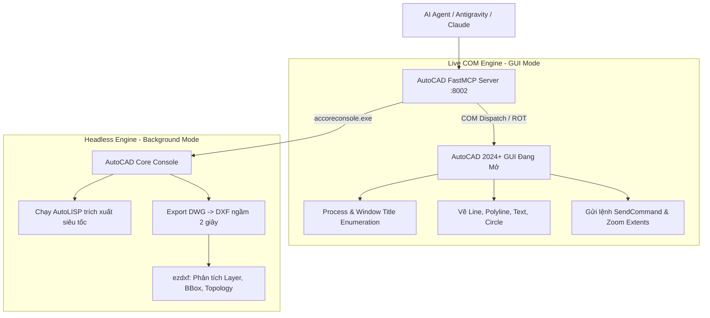
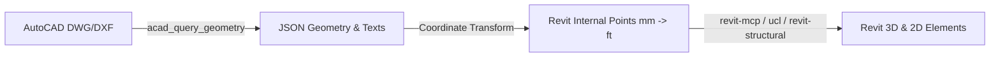

# AutoCAD MCP Agent Skill: Tự Động Hóa & Điều Phối Bản Vẽ CAD Bằng AI

Skill này là tài liệu chuẩn mực (Ground Truth) để AI Agent tương tác, trích xuất dữ liệu và điều khiển **Autodesk AutoCAD** một cách an toàn, chính xác và hiệu năng cao thông qua máy chủ **AutoCAD FastMCP Server** (`autocad_mcp/`).

---

## 1. Kiến Trúc Hai Chế Độ (Dual-Engine Architecture)

AutoCAD MCP Server vận hành theo mô hình kiến trúc kép linh hoạt:



### 1.1. Live COM Engine (Tương tác trực tiếp với phiên AutoCAD đang mở)
- **Mục đích**: Người dùng đang mở bản vẽ trên màn hình và muốn quan sát trực quan các thao tác vẽ, zoom, tạo layer, hoặc gửi lệnh.
- **Cơ chế**: Kết nối qua Windows ActiveX/COM API (`AutoCAD.Application`).
- **Quy tắc an toàn**: Không bao giờ gọi `win32com.client.Dispatch()` nếu `GetActiveObject()` thất bại nhằm tránh tự động sinh các tiến trình AutoCAD ngầm (ghost processes).

### 1.2. Headless Engine (Chạy ngầm tốc độ cao qua `accoreconsole` & `ezdxf`)
- **Mục đích**: Trích xuất dữ liệu hình học lớn (hàng nghìn điểm cáp DUL, cốt thép, lưới trục, ghi chú), xuất định dạng hoặc chạy hàng loạt mà không phụ thuộc vào GUI.
- **Tốc độ**: Chỉ mất 1–3 giây cho một bản vẽ lớn, không bao giờ bị đơ giao diện hay kẹt hộp thoại.
- **Thư viện ezdxf**: Đọc trực tiếp cấu trúc DXF độc lập với AutoCAD, truy vấn toạ độ với độ chính xác số học tuyệt đối.

---

## 2. Danh Sách Công Cụ AutoCAD MCP (Tools Reference)

| Tool Name | Tham Số Đầu Vào | Chức Năng Chi Tiết |
| :--- | :--- | :--- |
| **`acad_status`** | Không | Quét toàn bộ các phiên `acad.exe` đang chạy, trả về tên bản vẽ dự án thực tế, đường dẫn file trên ổ đĩa và trạng thái kết nối COM. |
| **`acad_get_layers`** | Không | Liệt kê toàn bộ Layer trong bản vẽ hiện hành kèm mã màu AutoCAD Color Index (ACI), trạng thái Lock, Freeze, và LayerOn. |
| **`acad_query_geometry`** | `dwg_path`, `layer_filter`, `entity_types`, `max_items` | Trích xuất toạ độ hình học và thông số của `LINE`, `LWPOLYLINE`, `TEXT`, `MTEXT`, `INSERT` (Block) ngầm không khóa GUI. |
| **`acad_export_dxf`** | `dwg_path`, `output_dxf` | Tự động xuất file DWG sang bản mã DXF chuẩn trong 2 giây phục vụ bóc tách toạ độ offline. |
| **`acad_inspect_dxf`** | `dxf_path` | Đọc danh sách Layer và thống kê số lượng từng loại đối tượng trong file DXF qua `ezdxf`. |
| **`acad_draw_line`** | `p1: [x,y,z]`, `p2: [x,y,z]`, `layer: str` | Vẽ đoạn thẳng Line trong ModelSpace và gán vào layer chỉ định. |
| **`acad_draw_polyline`** | `points: [[x,y],...]`, `closed: bool`, `layer: str` | Vẽ đường Polyline liên tục qua danh sách điểm (cáp ứng lực, tim dầm, chu vi sàn, móng). |
| **`acad_draw_circle`** | `center: [x,y,z]`, `radius: float`, `layer: str` | Vẽ đường tròn (lỗ mở, cọc khoan nhồi, trụ tròn, bong bóng trục). |
| **`acad_draw_text`** | `text`, `point: [x,y,z]`, `height`, `rotation_deg`, `layer` | Chèn ký hiệu hoặc ghi chú cao độ Text tại toạ độ chỉ định kèm góc xoay mong muốn. |
| **`acad_zoom_extents`** | Không | Zoom vừa khít toàn bộ đối tượng bản vẽ lên màn hình làm việc của AutoCAD. |
| **`acad_send_command`** | `command: str` | Gửi chuỗi lệnh hoặc biểu thức AutoLISP trực tiếp vào cửa sổ lệnh AutoCAD. |
| **`acad_purge_audit`** | `dwg_path: Optional[str]` | Dọn dẹp rác (Purge All Unused Layers/Blocks) và sửa lỗi cơ sở dữ liệu bản vẽ (Audit Database). |
| **`acad_run_headless_lisp`** | `dwg_path`, `lisp_code`, `timeout_sec` | Chạy trực tiếp một đoạn mã AutoLISP bất kỳ trên DWG qua `accoreconsole.exe`. |

---

## 3. Quy Chuẩn CAD SOPs & Safe Drafting Guardrails

> [!IMPORTANT]
> **Tuyệt đối tuân thủ 4 nguyên tắc an toàn dưới đây để tránh lỗi lệch toạ độ và treo tiến trình AutoCAD:**

### 3.1. Tiền kiểm tra (Pre-flight Inspection) & Xử lý Đa Tiến trình (Multi-Instance)
- Trước khi thực thi bất kỳ thao tác vẽ hoặc truy vấn nào, bắt buộc gọi `acad_status`.
- **Cơ chế chống bắt nhầm `Drawing1.dwg`**: Nếu người dùng mở nhiều cửa sổ AutoCAD, bộ lọc MCP tự động phân tích Window Title để ưu tiên bắt đúng tiến trình đang mở bản vẽ dự án (`*.dwg`), loại trừ các cửa sổ rỗng mặc định.

### 3.2. Bẫy bắt điểm tự động (The OSMODE Snap Trap)
- **Vấn đề**: Khi gửi lệnh vẽ tự động (`LINE`, `PLINE`, v.v.) qua `SendCommand`, nếu chế độ bắt điểm (`OSMODE`) đang bật, AutoCAD sẽ tự động hút điểm vẽ vào một Endpoint hoặc Midpoint gần đó khiến toạ độ bị sai lệch nghiêm trọng.
- **Quy chuẩn**: Luôn tắt bắt điểm trước khi vẽ và khôi phục lại khi hoàn thành:
  ```lisp
  (setq old_osm (getvar "OSMODE"))
  (setvar "OSMODE" 0)
  ;; Thực hiện các lệnh vẽ tự động...
  (setvar "OSMODE" old_osm)
  ```

### 3.3. Chống treo hộp thoại (Disable FILEDIA & CMDECHO)
- Trong các script tự động, luôn đặt:
  - `(setvar "CMDECHO" 0)`: Tắt in log lệnh làm chậm tiến trình.
  - `(setvar "FILEDIA" 0)`: Tắt hộp thoại đồ họa khi gọi các lệnh lưu, mở, xuất file (như `DXFOUT`, `SAVEAS`) để tránh AutoCAD treo ở trạng thái chờ người dùng click chuột.

### 3.4. Chuẩn hóa Góc Xoay & Toạ độ (Angles & Coordinates)
- **ActiveX/COM API**: Nhận góc xoay theo đơn vị **Radian** (cần dùng `math.radians(degrees)`).
- **AutoCAD LISP / Command Line**: Thường nhận góc xoay theo đơn vị **Độ (Degrees)**.
- **Hệ toạ độ**: Mọi toạ độ xuất nhập đều chuẩn hóa theo World Coordinate System (**WCS**). Không sử dụng UCS tạm thời chưa định danh.

---

## 4. Thư Viện Mẫu AutoLISP Chuẩn Sản Xuất (Production LISP Patterns)

### 4.1. Trích xuất toàn bộ Polyline trên một Layer ra file TXT/JSON
```lisp
(defun c:ExportPolylines ( / ss i ent ed pts f out_file)
  (vl-load-com)
  (setq out_file (strcat (getvar "DWGPREFIX") "polylines_dump.json"))
  (setq f (open out_file "w"))
  (write-line "[" f)
  (setq ss (ssget "X" '((0 . "*POLYLINE") (8 . "PT_CABLE*"))))
  (if ss
    (repeat (setq i (sslength ss))
      (setq ent (ssname ss (setq i (1- i))))
      (setq obj (vlax-ename->vla-object ent))
      (setq coords (vlax-safearray->list (vlax-variant-value (vla-get-Coordinates obj))))
      (write-line (strcat "{\"coords\": " (vl-prin1-to-string coords) "},") f)
    )
  )
  (write-line "]" f)
  (close f)
  (princ "\nDone exporting polylines.")
)
```

### 4.2. Trích xuất Text ghi chú cao độ CGS và góc xoay
```lisp
(defun c:ExportCGSTexts ( / ss i ent ed txt ins rot f out_file)
  (setq out_file (strcat (getvar "DWGPREFIX") "cgs_texts.txt"))
  (setq f (open out_file "w"))
  (setq ss (ssget "X" '((0 . "TEXT,MTEXT") (8 . "*CGS*,*CHAIR*"))))
  (if ss
    (repeat (setq i (sslength ss))
      (setq ent (ssname ss (setq i (1- i))))
      (setq ed (entget ent))
      (setq txt (cdr (assoc 1 ed)))
      (setq ins (cdr (assoc 10 ed)))
      (setq rot (cdr (assoc 50 ed)))
      (write-line (strcat txt "\t" (rtos (car ins) 2 3) "\t" (rtos (cadr ins) 2 3) "\t" (rtos rot 2 4)) f)
    )
  )
  (close f)
  (princ "\nDone exporting CGS text.")
)
```

---

## 5. Quy Trình Cầu Nối Đồng Bộ Hai Chiều CAD $\leftrightarrow$ Revit (BIM Coordination)

Khi phối hợp giữa **`autocad-mcp`** và **`revit-mcp`**, quy trình chuẩn gồm 3 bước:



### 5.1. Ma trận chuyển đổi Hệ Toạ độ (WCS $\rightarrow$ Revit Internal Coordinates)
Toạ độ CAD (mm) được chuyển đổi sang toạ độ Revit (feet, tỷ lệ $1\text{ ft} = 304.8\text{ mm}$):

$$\begin{bmatrix} X_{Revit} \\ Y_{Revit} \end{bmatrix} = \begin{bmatrix} \cos\theta & -\sin\theta \\ \sin\theta & \cos\theta \end{bmatrix} \begin{bmatrix} (X_{CAD} - X_0) / 304.8 \\ (Y_{CAD} - Y_0) / 304.8 \end{bmatrix}$$

- Trong đó: $(X_0, Y_0)$ là toạ độ điểm gốc tham chiếu CAD (thường là giao điểm hai trục chính như Trục A-1).
- $\theta$ là góc xoay giữa True North hoặc Project North trong Revit so với CAD.

### 5.2. Khử trùng lặp và Dung sai điểm (Tolerance Deduplication)
- Khi đọc tim dầm hoặc đường cáp từ CAD, các nét vẽ thường bị chia nhỏ (segmented).
- Phải áp dụng thuật toán gom cụm (Clustering) với dung sai khoảng cách $\text{tolerance} \approx 5\text{ mm}$ để nối các đoạn thẳng thành một polyline liên tục trước khi đẩy sang Revit API tạo `DirectShape` hoặc `DetailCurve`.
