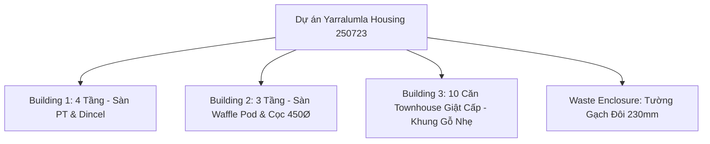

# Quy Chuẩn Kết Cấu HPCE (HPCE Structural BIM Standard)
### Dự án: Yarralumla Housing (Block 3, Section 59, Yarralumla ACT, Australia)
**Chủ đầu tư / Tổng thầu:** Monarch Building Solutions (MBS)  
**Tư vấn Kiến trúc:** Oztal Architects (`combined.pdf`)  
**Tư vấn Kết cấu:** HPCE Pty Ltd (`26.07.30 - combined.pdf` - Project Code: `250723`)  
**Mô hình Trung tâm:** `250723_Yarralumla_CENTRAL_R25_*.rvt` (Autodesk Revit 2025)

---

## 1. Bản Đồ Hồ Sơ Nguồn & Cấu Trúc Khối Nhà

Hệ thống kết cấu bao gồm 3 tòa nhà chính (**Building 1, Building 2, Building 3**) và 1 nhà rác (**Waste Enclosure**) với giải pháp kết cấu hoàn toàn khác biệt:



### Bảng Tổng Hợp Thông Số Kỹ Thuật Từng Tòa Nhà

| Hạng mục | Quy mô & Cao độ chính | Giải pháp kết cấu chuẩn HPCE | Bộ bản vẽ tương ứng |
| :--- | :--- | :--- | :--- |
| **Building 1** (Chung cư 4 tầng) | - Lower Ground (Hầm): `RL 567.400`<br>- Ground: `RL 570.600`<br>- Level 1: `RL 573.800`<br>- Roof: `RL 577.600` | - **Móng:** Móng đơn `PF1-PF3` trên đá, móng băng `SF1-SF2`, sàn hầm `100mm S.O.G`.<br>- **Thân:** Cột bê tông `CC01-CC04`, tường chắn đất `RW1`, tường Dincel `W1-W3, LW1, SW1`.<br>- **Sàn:** Sàn Dự ứng lực (PT Slab) dày 200–400mm (dải dầm bẹt 400mm).<br>- **Mái:** Cột thép `SC1 (89x89 SHS)`, dầm thép `SB1`, khung nhẹ `LB`, vì kèo `MRT`. | - Mặt bằng: `S200` $\rightarrow$ `S204`<br>- Cáp PT: `S300, S301`<br>- Thép sàn: `S400` $\rightarrow$ `S403`<br>- Mặt cắt: `S500, S600, S620, S621` |
| **Building 2** (Chung cư thấp tầng) | - Ground: `RL 568.700`<br>- Level 1: `RL 571.900`<br>- Roof: `RL 575.700` | - **Móng:** Hệ sàn hộp xốp **Waffle Pod Slab** trên cọc bê tông `450Ø Mass Concrete Piers`.<br>- **Tường:** Tường Dincel `W1, W3`, tường gạch đôi chịu lực `LBDBK` (230mm) và khung nhẹ `LB`.<br>- **Sàn L1:** Sàn bê tông cốt thép thường dày 200–250mm (không dùng cáp PT). | - Mặt bằng: `S210` $\rightarrow$ `S213`<br>- Thép sàn: `S410, S411`<br>- Chi tiết & Mặt đứng: `S501, S603` |
| **Building 3** (10 căn Townhouse: Unit 21 $\rightarrow$ 30) | - Ground giật cấp 5 bậc: `RL 567.230` $\rightarrow$ `566.030`<br>- Level 1 giật cấp: `RL 570.250` $\rightarrow$ `569.070` | - **Móng:** Sàn Waffle Pod kết hợp cọc 450Ø và móng băng sân vườn `SF1, SF2`.<br>- **Thân & Mái (100% Khung nhẹ):** Sàn gỗ dầm phụ (`Floor Joists - FJ`), dầm gỗ kỹ thuật LVL (`TB`), vách ngăn căn hộ chống cháy (`TPW`), cột đôi `DS`, kèo mái `MRT`. (*View 3D bìa `S000` chính là Building 3*). | - Mặt bằng: `S220` $\rightarrow$ `S222`<br>- Mặt đứng: `S604` |
| **Waste Enclosure** (Nhà rác) | - Nền: `RL 567.400` | - Tường gạch đôi sân vườn `CDBK` dày 230mm, móng băng `SF1`, sàn nền `100 S.O.G`. | - Mặt bằng: `S200, S201` |

---

## 2. Ma Trận Đối Chiếu Kiến Trúc (Oztal) $\rightarrow$ Kết Cấu (HPCE)

### 2.1. Lưới Trục & Hệ Khung Scope Box
1. **Lưới trục riêng theo từng tòa:**
   - **Building 1:** Trục ngang `1-A` đến `1-M`, trục dọc `1-1` đến `1-5`.
   - **Building 2:** Trục ngang `2-A` đến `2-F`, trục dọc `2-1` đến `2-2`.
   - **Building 3:** Trục ngang `3-A` đến `3-K`, trục dọc `3-1` đến `3-2`.
2. **Hệ thống 3 Scope Box:**
   - Tạo 3 Scope Box độc lập: `Building 1`, `Building 2`, `Building 3`.
   - **Quy tắc xoay Building 1:** Trên tổng mặt bằng `A001.1`, Building 1 nằm nghiêng góc $\approx 45^\circ$. Xoay Scope Box `Building 1` song song với cạnh công trình để khi gán vào View, mặt bằng tự động xoay ngang ngay ngắn theo đúng khổ giấy A1.

### 2.2. Quy Tắc Cao Độ: `SLAB RL` vs `FFL RL`
> [!IMPORTANT]
> Trên bản vẽ Kiến trúc luôn ghi đồng thời `FFL RL` (Finished Floor Level) và `SLAB RL` (Slab Structural Level).  
> **Nguyên tắc bất di bất dịch của HPCE:** Mọi Level trong Revit Structure **bắt buộc tạo theo `SLAB RL`** (thấp hơn `FFL RL` 20mm):
> $$\text{SLAB RL} = \text{FFL RL} - 20\text{ mm}$$

* **Quy tắc giật cấp Building 3:** Chỉ tạo 2 Level chuẩn (`B3 - Ground Floor RL 567230` và `B3 - Level 1 RL 570250`). Khi dựng sàn/tường cho các cặp căn hộ giật cấp thấp dần, nhập biến **Height Offset From Level** (`-300`, `-600`, `-900`, `-1200mm`) để tránh tạo quá nhiều Level gây rối bản vẽ.
* **Quy tắc hạ cốt sàn 50mm (Wet Area Setdown):** Các khu vực vệ sinh, phòng tắm, ban công khoanh nét đứt trên bản vẽ `CSP` tương ứng với `T0 STEP = 50 FALL` (hạ cốt sàn 50mm). Tạo ô sàn riêng với `Height Offset = -50mm`.

### 2.3. Ma Trận Chuyển Đổi Tường: Bóc Tách Lõi Chịu Lực (Structural Core Only)
Bỏ qua toàn bộ lớp hoàn thiện thạch cao (plasterboard), lớp xốp cách nhiệt (insulation), lớp ốp ngoài:

| Mã Kiến Trúc (Oztal) | Cấu tạo chi tiết Kiến Trúc | Mã Kết Cấu (HPCE) | Chiều dày gán trong Revit |
| :--- | :--- | :--- | :--- |
| `WT-2`, `WT-3`, `WT-5` | 200mm Thick Dincel Wall + Plasterboard | **`W1`, `LW1` (Lift), `SW1` (Stair), `RW1`** | `200 mm` (Dincel Concrete Core) |
| `WT-1`, `WT-8`, `WT-9` | 155mm Thick Dincel Wall | **`W2`, `W3`** | `155 mm` (Dincel Concrete Core) |
| `WT-12` (B1), `WT-6` (B2) | 230mm Double Brick Wall | **`LBDBK` (Load Bearing) / `CDBK` (Courtyard)** | `230 mm` (Masonry Brick) |
| `WT-4` | 270mm Retaining Brick Wall | **`CRDBK`, `RBW1`** | `270 mm` (Brick + Grout Cavity) |
| Vách căn hộ ngăn cháy | 250–280mm Lightweight Party Wall | **`TPW(u)` / `TPW(o)`** | `250 mm` – `280 mm` (Stud Wall) |
| Tường khung xương nhẹ | 90mm Stud Wall | **`LB(u)` / `LB(o)`** | `90 mm` (Lightweight Stud) |

---

## 3. Ranh Giới Kỹ Thuật Tuyệt Đối: 3D Model vs 2D Drafting

Nhằm tránh phình to dung lượng mô hình, đảm bảo hiệu năng máy và đúng chuẩn thực tế của HPCE:

```
┌────────────────────────────────────────────────────────────────────────┐
│                   HỒ SƠ BẢN VẼ KẾT CẤU HPCE (48 SHEETS)                │
├───────────────────────────────────┬────────────────────────────────────┤
│         DỰNG 3D MODEL             │          VẼ 2D DRAFTING            │
├───────────────────────────────────┼────────────────────────────────────┤
│ • Móng đơn PF1-PF3, móng băng SF  │ • Hộp xốp Waffle Pod (1090x1090mm) │
│ • Cột bê tông CC01-CC04, cọc 450Ø │ • Cáp DƯL Post-Tensioning (S300/1) │
│ • Tường Dincel W1-W3, vách LW1/SW1│ • Cốt thép sàn Top/Bottom (S400/11)│
│ • Sàn BTCT hầm, trệt, lầu (S.O.G) │ • Ký hiệu giật cấp Z-Step 50mm     │
│ • Bậc giật cấp sàn & mép Slab Edge│ • Thép tăng cường chữ U, L, đai    │
│ • Khung thép SC1, SB1, dầm gỗ TB  │ • Toàn bộ Standard Details (S100+) │
│ • View 3D phối cảnh bìa (S000)    │ • Bảng ghi chú tải trọng (S004-6)  │
└───────────────────────────────────┴────────────────────────────────────┘
```

> [!CAUTION]
> **3 Điểm Cấm Kỵ Tuyệt Đối Không Dựng 3D:**
> 1. **CẤM dựng 3D hàng ngàn hộp xốp Waffle Pod:** Dùng `Annotate` $\rightarrow$ `Detail Component` / `Filled Region` rải ô vuông nét đứt $1090 \times 1090\text{ mm}$ trên mặt bằng trệt `S211`, `S220`.
> 2. **CẤM dựng Rebar 3D toàn bộ sàn:** Dùng 2D Detail Components (thanh thép gạch chéo 2 đầu, đường gióng chấm tròn, tag `N12-200`, lưới `SL82 MESH TOP`).
> 3. **CẤM mô hình hóa 3D tao cáp PT:** Dùng đường cáp 2D, family ký hiệu neo kéo (Live End) / neo chết (Dead End) và TextNote ghi cao độ CGS trên `S300`, `S301`.

---

## 4. Giải Mã Ký Hiệu Mặt Bằng Kết Cấu Tiêu Chuẩn Úc

### 4.1. Quy Ước Chiều Cao `(u)` và `(o)` Trên Mặt Bằng
* **`(u)` = Under (Bên dưới mặt sàn đang cắt):** Cấu kiện đỡ bên dưới (chân sàn đi xuống). Thể hiện bằng **nét đứt nét mảnh**, tô màu **xám nhạt**.
* **`(o)` = Over (Bên trên mặt sàn đang cắt):** Cấu kiện đứng trên mặt sàn đi lên tầng trên. Thể hiện bằng **nét liền đậm kèm hatch bê tông / gạch chéo**.
* **Hatch đặc màu đen / đậm (Under & Over):** Cấu kiện đi xuyên suốt liên tục từ tầng dưới lên tầng trên.

### 4.2. Ký Hiệu Cốt Thép & Vật Liệu Tiêu Chuẩn Úc (AS 3600 / AS 2870)
* **`N12-200`:** Thép gân cường độ cao ($500\text{ MPa}$), đường kính $12\text{ mm}$, khoảng rải $a = 200\text{ mm}$.
* **`4N16-100 4000L`:** 4 thanh thép gân D16, khoảng cách 100mm, chiều dài thanh $4000\text{ mm}$.
* **`SL82 MESH TOP`:** Lưới thép hàn cường độ cao (Square Mesh), dây thép phi $8\text{ mm}$, ô lưới $200 \times 200\text{ mm}$, đặt ở lớp trên.
* **`100 S.O.G`:** Sàn đổ trực tiếp trên đất (Slab On Ground) dày 100mm.
* **`450Ø Mass Concrete Pier`:** Cọc bê tông đại trà đường kính 450mm ngàm vào tầng đá/sỏi chịu lực.
* **`DS(u)` / `DS(o)`:** Cột gỗ ghép đôi (Double Stud).
* **`TB`:** Dầm gỗ kỹ thuật (Timber Beam LVL).
* **`FJ`:** Hệ dầm phụ đỡ sàn gỗ (Floor Joists).
* **`MRT`:** Vì kèo mái chế tạo sẵn tại nhà máy (Manufactured Roof Truss).

---

## 5. Quy Trình Thiết Lập 4 Loại Mặt Bằng & View Templates

Mỗi tầng được nhân bản thành 4 mặt bằng chuyên biệt từ cùng một mô hình:

### 5.1. Mặt Bằng Định Vị Kết Cấu (Marking Plans: `S200` $\rightarrow$ `S230`)
1. **View Direction:** `Structural Plan` nhìn **Down (Nhìn xuống)**.
2. **Bộ Lọc View Filters:**
   - Filter `HPCE_Wall_Under`: `Top Constraint == Current Level` $\rightarrow$ Nét đứt nét mảnh, Pattern Solid Xám `#C0C0C0`.
   - Filter `HPCE_Wall_Over`: `Base Constraint == Current Level` $\rightarrow$ Nét liền đậm, Hatch bê tông hoặc Masonry.
3. **Bảng Thống Kê Đi Kèm:** Đặt bảng Schedule hoặc Legend góc phải bản vẽ (`IN-SITU WALL SCHEDULE`, `BRICK WALL SCHEDULE`, `STRIP FOOTING SCHEDULE`).

### 5.2. Mặt Bằng Tải Trọng Thiết Kế (Loading Plans: `S004`, `S005`, `S006`)
* Thu nhỏ tỷ lệ để xếp 3–4 tầng vào chung 1 tờ A1. Mô hình nền đưa về **Halftone**.
* Áp dụng `Filled Region` theo bảng màu chuẩn **LOADING LEGEND**:
  - **INTERNAL (Căn hộ):** Xanh rêu / vàng ô vuông ($SDL = 1.0\text{ kPa}, LL = 1.5\text{ kPa}$).
  - **CORRIDOR (Hành lang):** Vàng nhạt ($SDL = 1.0\text{ kPa}, LL = 3.0\text{ kPa}$).
  - **COURTYARD / BALCONY (Sân vườn/Ban công):** Hồng đậm / hồng phấn.
  - **LIGHTWEIGHT ROOF (Mái nhẹ):** Sọc chéo xanh dương ($SDL = 0.4\text{ kPa}, LL = 0.25\text{ kPa}$).

### 5.3. Mặt Bằng Cáp Dự Ứng Lực (Post-Tensioning Plans: `S300`, `S301`)
* Tắt toàn bộ khung nhẹ và tường phụ, chỉ giữ mép sàn, cột, vách cứng và lỗ mở.
* Vẽ đường cáp (Tendon Line), đặt family neo kéo (Live End - tam giác đen) và neo chết (Dead End - chữ T).
* Ghi chú chuỗi cao độ CGS (chữ số dọc theo sợi cáp: `115`, `200`, `30`, `180`...) xoay đúng theo phương của từng sợi cáp.
* Ghi số lượng tao cáp ở đầu bó cáp trên trục biên (ví dụ bó `1` đến `27`, ghi `4` hoặc `5` tao D12.7mm).

### 5.4. Mặt Bằng Cốt Thép Sàn (Reinforcement Plans: `S400` $\rightarrow$ `S411`)
* Mỗi sàn chia làm 2 tờ riêng: **Bottom Reinforcement (Lớp dưới)** và **Top Reinforcement (Lớp trên)**.
* Thể hiện thanh thép bằng 2D Detail Component (đường nét có 2 dấu chéo giới hạn vùng rải, đường gióng có chấm tròn).
* Vùng ban công và rìa sàn trải lưới `SL82 MESH TOP` dùng `Filled Region` sọc ngang dày.

---

## 6. Đóng Bộ 48 Sheets, Căn Chỉnh Viewport & Xuất PDF

### 6.1. Thiết Lập Khung Tên Tiêu Chuẩn (TitleBlock A1)
* Khổ giấy: **ISO A1 ($841 \times 594\text{ mm}$)**.
* Thông tin dự án (Project Information):
  - **Project Name:** `YARRALUMLA HOUSING - BLOCK 3, SECTION 59, YARRALUMLA ACT`
  - **Project Number:** `250723`
  - **Current Revision:** `A` | **Date:** `24.06.2026` | **Issue:** `ISSUED FOR CONSTRUCTION`
* Trang `S001`: Đặt bảng danh mục bản vẽ (`Sheet List Schedule`) ngắt làm 2 cột lớn chứa toàn bộ 48 bản vẽ.

### 6.2. Căn Chỉnh Vị Trí Viewport Tự Động Qua MCP (EF-Tools Pattern)
Khi dàn trang nhiều tầng, kích hoạt công cụ:
```python
align_viewports_across_sheets(
    main_sheet_number="S201",
    target_sheet_numbers=["S202", "S203", "S204", "S300", "S301", "S400", "S401", "S402", "S403"],
    apply_crop_scope_box=True,
    align_titleblock=True,
    align_legend=True
)
```
*Thuật toán tự động bật Temporary Hide để thu hẹp BoundingBox về ranh CropBox, đảm bảo công trình khớp vị trí tuyệt đối khi lật trang.*

### 6.3. Tiêu Chuẩn Xuất File PDF (`26.07.30 - combined.pdf`)
* **Output Name:** `26.07.30 - combined.pdf`
* **Sheet Range:** Đủ 48 trang từ `S000` đến `S710`.
* **Paper Size:** `ISO A1 (841 x 594 mm)`.
* **Zoom:** Bắt buộc chọn **`Zoom: 100%`** (Tuyệt đối không chọn *Fit to page*).
* **Color:** Chọn **`Color`** (giữ nguyên màu 3D Shaded ở tờ `S000`, màu tải trọng ở `S004-S006` và cọc xanh/đỏ ở `S210-S220`).

---

## 7. Quy Chuẩn Kỹ Thuật & Bộ Công Cụ Bố Trí Cốt Thép HPCE (Rebar Standard & PyRebar Tooling)

### 7.1. Tiêu Chuẩn Cốt Thép & Lớp Bảo Vệ Úc (AS 3600 / AS 2870)
* **Chủng loại cốt thép tiêu chuẩn:**
  * **Grade 500N (Thép gân chịu lực chính):** `N12, N16, N20, N24, N28, N32` ($f_y = 500\text{ MPa}$).
  * **Grade 500L (Lưới thép hàn cường độ cao):** `SL82, SL92, SL102` (ô lưới $200 \times 200\text{ mm}$).
  * **Grade 250R (Thép tròn trơn - làm đai hoặc liên kết nhẹ):** `R10, R12` ($f_y = 250\text{ MPa}$).
* **Chiều dày lớp bê tông bảo vệ tiêu chuẩn (Rebar Cover - AS 3600):**
  * **Móng tiếp xúc đất / bê tông lót (Footings):** $50\text{ mm}$ (nếu đổ trực tiếp không lót: $75\text{ mm}$).
  * **Tường chắn đất tiếp xúc đất (Retaining Wall RW1, hầm):** $40\text{ mm}$.
  * **Cột & Dầm ngoài trời (External Columns/Beams):** $40\text{ mm}$; trong nhà: $30\text{ mm}$.
  * **Vách trong nhà & Tường Dincel (W1-W3, Lift/Stair):** $25\text{ mm} - 30\text{ mm}$.
  * **Bản sàn trong nhà (Internal Slabs):** $20\text{ mm} - 25\text{ mm}$.

### 7.2. Quy Tắc Bố Trí Cốt Thép Cấu Kiện Theo Hồ Sơ HPCE (250723)
1. **Tường Dincel & Vách Bê Tông (`IN-SITU WALL SCHEDULE`):**
   * **Tường Dincel 155mm (`W2`, `W3`):** Bố trí 1 lớp thép ở tâm lõi $\rightarrow$ `N12-400 CENTRAL` (hoặc `N12-300` theo tầng chịu tải).
   * **Vách Dincel 200mm / Lõi Thang Máy (`LW1`, `SW1`):** Bố trí 2 lớp thép hai bên $\rightarrow$ `N12-200 EW` (Each Way - cả phương đứng và phương ngang).
   * **Chân tường Dincel ngàm sàn:** Bắt buộc bố trí thép chờ **Starter Bars** (Dowels) `N12-400`, chiều dài ngàm tối thiểu $40d = 480\text{ mm}$.
2. **Móng Đơn (`PF1-PF3`) & Móng Băng (`SF1-SF2`):**
   * **Lưới thép đáy móng:** `N16-150 B.W.` (Both Ways) bẻ mỏ neo $30d - 40d$.
   * **Cốt thép dầm móng băng:** 3N20 trên + 3N20 dưới, đai `R10-150` khép kín.
3. **Cột Bê Tông (`CC01-CC04`):**
   * **Thép chủ:** Tối thiểu 4N20 (cột góc/biên) hoặc 8N20 (cột giữa tầng hầm), neo vào sàn/móng $\ge 40d$.
   * **Thép đai:** Đai `R10` khép kín, gia cường đai dày ở 2 đầu chân và đỉnh cột khoảng cách $a100$ (trong đoạn $h/6$ hoặc tối thiểu $500\text{ mm}$), giữa cột $a200$.
4. **Dầm Bê Tông & Dầm Bẹt Sàn PT:**
   * Thép đai kín `StirrupTie` chống cắt và chống xoắn. Thép tăng cường gối vươn ra $L/3$, thép nhịp cách mép gối $0.15L - 0.2L$.
5. **Mặt Bằng Thép Sàn (`S400` Series):**
   * Phân tách 2 mặt bằng: **Bottom Reinforcement** (lớp dưới - thép chạy suốt) và **Top Reinforcement** (lớp trên - gia cường gối/dầm).
   * Ban công và mép sàn biên phủ lưới `SL82 MESH TOP`.

### 7.3. Tích Hợp Bộ Công Cụ PyRebar ([PyRebar.extension](file:///C:/Users/Admin/AppData/Roaming/pyRevit/Extensions/PyRebar.extension))
Bộ công cụ `PyRebar` (cài sẵn tại `C:\Users\Admin\AppData\Roaming\pyRevit\Extensions\PyRebar.extension`) được quy định làm công cụ tiêu chuẩn để kiểm toán và xử lý cốt thép:
1. **Kiểm toán chất lượng tự động (Rebar Audit & QA/QC):**
   * **Phát hiện thép trùng lặp (Duplicated Bars):** Tự động so sánh BoundingBox sai số $1\text{ mm}$ + Host ID + đường kính để phát hiện và loại bỏ các thanh thép bị copy đè lên nhau, bảo vệ tính toàn vẹn của bảng dự toán.
   * **Cảnh báo thanh thép quá dài ($> 12.000\text{ mm}$):** Nhắc nhở bố trí mối nối chồng (Lap Splice) khi thép vượt quá chiều dài thanh xuất xưởng ($12\text{m}$).
   * **Cảnh báo thanh thép quá ngắn ($< 100\text{ mm}$):** Loại bỏ các vụn thép vẽ sai.
   * **Bảng thống kê theo đường kính (Statistics by Diameter):** Tổng hợp tức thì số lượng thanh theo từng cỡ $\varnothing 10, \varnothing 12, \varnothing 16, \varnothing 20...$
2. **Tính toán hàm lượng cốt thép cấu kiện (Rebar Ratio):**
   * Trích xuất trực tiếp thể tích bê tông thực tế `HOST_VOLUME_COMPUTED` ($m^3$) và khối lượng thép ($kg$) của Cột, Dầm, Vách, Móng:
     $$\text{Rebar Ratio} = \frac{\sum M_{\text{rebar}} (\text{kg})}{V_{\text{concrete}} (m^3)} \quad (\text{kg/m}^3)$$
   * Đối chiếu nhanh với định mức chuẩn: Dầm ($120 - 180\text{ kg/m}^3$), Cột ($150 - 250\text{ kg/m}^3$), Vách Dincel ($70 - 110\text{ kg/m}^3$).
3. **Hiển thị đồ họa tự động (Unobscure & Solid 3D):**
   * Sử dụng lệnh `Unobscure Bars` (`rebar.SetUnobscuredInView(view, True)`) và `SetSolidInView(view, True)` để toàn bộ cốt thép hiển thị khối đặc 3D xuyên qua bê tông trong các view chi tiết và 3D phối cảnh.
4. **Hiệu chỉnh hình học an toàn (Reverse Hook):**
   * Đảo chiều móc thép (`Left` $\leftrightarrow$ `Right`) tự động khi móc bị quay ngược ra ngoài mép cấu kiện mà không làm hỏng định dạng Rebar Shape.
5. **Chuẩn hóa Phân Vùng Quản Lý (Rebar Partition):**
   * Mọi thanh thép khi tạo bắt buộc gán tham số `REBAR_ELEM_SCHEDULE_PARTITION` theo mã chuẩn:
     * `B1_BASEMENT_FOOTING`: Móng đơn và móng băng B1.
     * `B1_L0_DINCEL_W1`: Tường Dincel W1 tầng Ground B1.
     * `B1_L1_PT_SLAB`: Thép sàn và thép dầm bẹt L1.
     * `B2_WAFFLE_PIERS`: Cọc và dầm móng hộp xốp B2.

### 7.4. Cẩm Nang Xử Lý Sự Cố Cốt Thép (Rebar Troubleshooting SOP)
* **Sự cố 1: Thanh thép bị chìm trong khối bê tông (không nhìn thấy trong 3D):**
  $\rightarrow$ Chạy lệnh `Unobscure` hoặc gọi script API `rebar.SetUnobscuredInView(doc.ActiveView, True)` và `rebar.SetSolidInView(doc.ActiveView, True)`. Đảm bảo Detail Level của View là **Fine**.
* **Sự cố 2: Báo lỗi xung đột BoundingBox / Lớp bảo vệ (Cover Conflict):**
  $\rightarrow$ Kiểm tra tham số `CLEAR_COVER_OTHER`, `CLEAR_COVER_TOP`, `CLEAR_COVER_BOTTOM` của Host Element trước khi sinh curve. Tọa độ đường uốn thép bắt buộc thụt vào tối thiểu bằng giá trị Cover của cấu kiện.
* **Sự cố 3: Móc thép bị quay sai hướng (đâm ra ngoài cấu kiện):**
  $\rightarrow$ Kích hoạt tool `Reverse Hook` của PyRebar (`rebar.SetHookOrientation(0, Left/Right)`).
* **Sự cố 4: Sai lệch khối lượng dự toán cốt thép:**
  $\rightarrow$ Chạy lệnh `Audit Rebars` để quét toàn bộ nhóm thép trùng lặp (Duplicated Groups) và xóa các ID trùng trước khi xuất bảng khối lượng `structural_qto.py`.

