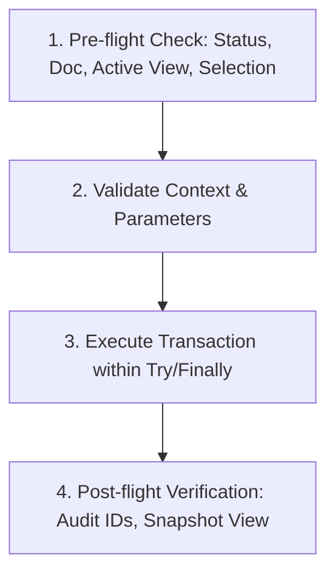

# Revit MCP Agent Skill: Điều Phối Mô Hình BIM & Quản Trị Revit API An Toàn

Skill này là tài liệu chuẩn mực (Ground Truth) để AI Agent điều khiển Autodesk Revit một cách an toàn, tin cậy qua MCP Server (`mcp-server-for-revit-python`), tổng hợp tinh hoa từ các repository hàng đầu thế giới:
- **REVIT_MCP_study**: Quy chuẩn BIM SOP (buộc truy vấn trước khi sửa đổi).
- **Daniel Locatelli (skills for AEC)**: Chống ảo giác API Revit đời cũ (.NET 8/10, ForgeTypeId, Revit 2024–2027).
- **Nonica-Revit-MCP-Skill & DDC**: Kiểm toán mô hình, trích xuất dữ liệu thông số, quản lý View/Sheet.
- **CLI_Revit, AEC Pilot, Portravo & ArchLang**: 4 Trụ cột tự động hóa nâng cao (Tối ưu token bằng Script Registry, liên thông CAD-Revit-Navisworks, QTO sang BOQ, và Linting quy chuẩn mặt bằng).

---

## 1. Nguyên Tắc Vàng: BIM SOP & Pre-flight Inspection

> [!IMPORTANT]
> **Tuyệt đối KHÔNG ĐƯỢC PHÉP thực thi sửa đổi (Write Action) khi chưa thực hiện truy vấn tiền kiểm tra (Pre-flight Check).**

Mọi thao tác can thiệp mô hình bắt buộc phải tuân theo chu trình 4 bước:



### Bước 1: Tiền kiểm tra (Pre-flight Check)
1. **Kiểm tra trạng thái máy chủ MCP**:
   - Gọi `GET http://localhost:48884/revit_mcp/status/`
   - Xác nhận `status == "active"` và `doc.Title` đúng dự án mong muốn.
2. **Kiểm tra View / Level hiện hành**:
   - Xác định `doc.ActiveView` hoặc truy vấn đúng View theo tên (`DB.FilteredElementCollector(doc).OfClass(DB.View)`).
   - Kiểm tra `View.Scale`, `View.ViewTemplateId`, và `View.GetCropRegionShapeManager()`.
3. **Kiểm tra Selection (nếu người dùng yêu cầu thao tác trên đối tượng đang chọn)**:
   - Truy vấn `uidoc.Selection.GetElementIds()`. Nếu rỗng, hỏi lại người dùng hoặc chọn theo tiêu chí cụ thể.

---

## 2. Từ Điển Chống Ảo Giác Revit API (Revit 2024–2027 Guardrails)

Rất nhiều AI Agent mắc lỗi sinh mã Revit API phiên bản cũ (2018–2021) gây crash hoặc lỗi biên dịch trên Revit 2024, 2025, 2026. Bảng sau là quy chuẩn bắt buộc:

| Hạng mục | ❌ API Cũ (CẤM DÙNG) | ✅ Modern Revit API (BẮT BUỘC DÙNG) | Giải thích & Ví dụ |
| :--- | :--- | :--- | :--- |
| **Định danh ElementId** | `elem.Id.IntegerValue` | `elem.Id.Value` (hoặc hàm hỗ trợ đa phiên bản) | Trong Revit 2024+, `ElementId` được nâng cấp lên `Int64`. Dùng `elem.Id.Value` hoặc `get_id_val(id)`. |
| **Kiểu tham số** | `param.Definition.ParameterType` | `param.GetDataType()` (ForgeTypeId) | `ParameterType` đã bị Autodesk khai tử từ Revit 2022/2023. Thay bằng `SpecTypeId` / `ForgeTypeId`. |
| **Chuyển đổi Đơn vị** | `UnitUtils.ConvertFromInternalUnits(val, DisplayUnitType.DUT_MILLIMETERS)` | `UnitUtils.ConvertFromInternalUnits(val, UnitTypeId.Millimeters)` | `DisplayUnitType` bị thay bằng `UnitTypeId`. |
| **Đơn vị Độ dài** | `UnitType.UT_Length` | `SpecTypeId.Length` | `UnitType` enum đã bị xóa bỏ hoàn toàn. |
| **Tên View** | Đặt tên chứa `{}` như `{3D - TEST}` | Đặt tên sạch như `3D - TEST` | Dấu ngoặc nhọn `{}` được Revit dành riêng cho View mặc định hệ thống. Đặt tên có `{}` sẽ ném ngoại lệ. |
| **Kiểm tra Chiều dài Curve** | Không kiểm tra khoảng cách điểm | Khoảng cách $> 20\text{ mm}$ ($0.065\text{ ft}$) | Nếu 2 điểm cách nhau $< 1.6\text{ mm}$, Revit ném lỗi `Exception: Curve length is too small`. |

### Đoạn mã Mẫu: Hàm Đa Phiên Bản An Toàn
```python
def get_elem_id_value(element_id):
    """Safely get int/int64 value from ElementId across all Revit versions (2020-2027)"""
    if hasattr(element_id, "Value"):
        return element_id.Value  # Revit 2024+
    return element_id.IntegerValue  # Revit <= 2023
```

---

## 3. Quản Trị Transaction & Xử Lý Ngoại Lệ

> [!CAUTION]
> Không bao giờ để hở Transaction nếu xảy ra lỗi. Phải luôn rollback để tránh làm hỏng trạng thái Undo/Redo của phiên làm việc Revit.

### Mẫu Transaction Chuẩn
```python
t = DB.Transaction(doc, "Descriptive Action Name")
try:
    t.Start()
    
    # Thực hiện các thao tác sửa đổi ở đây
    # ...
    
    status = t.Commit()
    if status != DB.TransactionStatus.Committed:
        print("Warning: Transaction was not committed successfully")
except Exception as ex:
    if t.HasStarted() and not t.HasEnded():
        t.RollBack()
    print("Error during execution: " + str(ex))
    raise
```

---

## 4. Các Nhóm Tác Vụ Thường Gặp Qua MCP

### 4.1 Kiểm toán mô hình (Model Auditing) & Truy vấn
- Sử dụng `FilteredElementCollector` kết hợp bộ lọc nhanh (`WhereElementIsNotElementType()`, `OfCategory()`, `OfClass()`).
- Tránh gọi `.ToElements()` nếu số lượng phần tử quá lớn ($> 50,000$ đối tượng), thay vào đó duyệt `GetElementIdIterator()`.

### 4.2 Thiết lập View & Thể hiện Bản vẽ
- **DirectShape 3D Curve trong Floor Plan**: DirectShape dạng đường hở (open spline/curve) **không có thể tích đặc** nên vô hình trên mặt bằng sàn cắt ngang. Bắt buộc vẽ kết hợp bằng `DetailCurve` 2D.
- **Xoay Chữ theo Scope Box**:
  - `TextNote.Create` trên View có Scope Box mặc định có `BaseDirection` song song với `View.RightDirection`.
  - Muốn chữ xoay theo phương đứng (`View.UpDirection`), chỉ xoay góc chênh lệch:
    $$\Delta\theta = \text{atan2}(V_{\text{up}}.Y, V_{\text{up}}.X) - \text{atan2}(\text{BaseDirection}.Y, \text{BaseDirection}.X)$$

### 4.3 Quản lý Thông số (Parameters)
```python
def set_param_safe(element, param_name_or_bip, value):
    """Safely set element parameter supporting both string names and BuiltInParameter"""
    if isinstance(param_name_or_bip, DB.BuiltInParameter):
        p = element.get_Parameter(param_name_or_bip)
    else:
        p = element.LookupParameter(param_name_or_bip)
    
    if p and not p.IsReadOnly:
        if p.StorageType == DB.StorageType.String:
            p.Set(str(value))
        elif p.StorageType == DB.StorageType.Double:
            p.Set(float(value))
        elif p.StorageType == DB.StorageType.Integer:
            p.Set(int(value))
        elif p.StorageType == DB.StorageType.ElementId:
            p.Set(value if isinstance(value, DB.ElementId) else DB.ElementId(int(value)))
        return True
    return False
```

---

## 5. Hậu Kiểm & Tự Xác Thực (Self-Verification)

Mỗi kịch bản sửa đổi qua MCP phải kết thúc bằng báo cáo tự kiểm thử:
1. **Số lượng đối tượng thành công / thất bại**: Ví dụ `Created 471 cables, 286 ticks, 291 texts`.
2. **Kiểm tra trực quan (Visual Verification)**: Gọi endpoint xuất ảnh `GET /revit_mcp/views/export/` hoặc crop vùng can thiệp để kiểm chứng kết quả trên màn hình trước khi thông báo cho người dùng.
