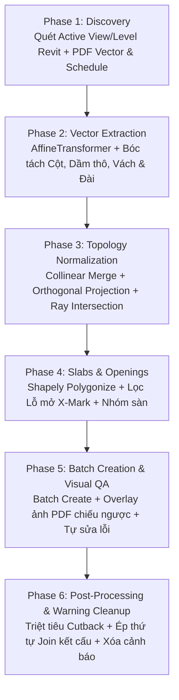

# SKILL: Tự Động Dựng Mô Hình Revit Kết Cấu Từ PDF Vector Qua MCP (Chuẩn HPCE)

> **Dự án đang làm (HPCE 250793 – Kai Huskisson):** đọc `.agents/projects/250793/README.md` trước khi tiếp tục.

Skill này cung cấp quy trình tự động hóa khép kín 1-Chạm để đọc hiểu bản vẽ kết cấu PDF (Vector PDF) và mô hình hóa trực tiếp vào Autodesk Revit hiện hành mà **người dùng không cần nhớ hay nhập các câu lệnh tham số phức tạp**.

---

## 1. NGUYÊN TẮC CỐT LÕI (STRICT RULES)

1. **CẤM ĐOÁN TỌA ĐỘ BẰNG MẮT (No Visual Coordinate Guessing):**
   - Tuyệt đối KHÔNG nhìn ảnh chụp PDF rồi tự ước lượng tọa độ `(X, Y)` để gọi MCP tool.
   - Mọi tọa độ hình học PHẢI được trích xuất từ dữ liệu vector của PDF thông qua thư viện Python `PyMuPDF` (`fitz`) và xử lý hình học bằng `Shapely`.
   - Khả năng thị giác (Vision) chỉ được dùng để: đọc Bảng thống kê (Schedule Tables), đọc Ghi chú chung (General Notes), và kiểm tra chéo (QA/QC) sau khi đã dựng hình.

2. **BẮT BUỘC ĐỒNG BỘ HỆ TỌA ĐỘ QUA LƯỚI TRỤC (Grid-First Calibration):**
   - Không được phép dựng bất kỳ Cột, Dầm hay Sàn nào trước khi xác lập được **Ma trận biến đổi Affine (`AffineTransformer`)** dựa trên tối thiểu 2 giao điểm trục Grid (ví dụ: giao điểm `A-1` và `H-10`) giữa PDF và Revit.
   - Luôn nhớ: Trục `Y` của PDF hướng từ trên xuống dưới, trong khi trục `Y` của Revit hướng từ dưới lên trên (phải đảo dấu `-y_pdf` trước khi tính toán).

3. **ĐƠN VỊ VÀ HỆ QUY CHIẾU (Units & Reference):**
   - Toàn bộ dữ liệu trung gian trong JSON gửi qua MCP đều tính bằng **Milimet (`mm`)** làm tròn đến `0.1 mm`.
   - Việc quy đổi từ `mm` sang `Decimal Feet` (`mm / 304.8`) do tầng Revit API đảm nhiệm.

4. **THỰC THI THEO LÔ (Batch Execution Only):**
   - Không gọi MCP tool lẻ tẻ cho từng thanh dầm hay từng cây cột. Phải gom toàn bộ cấu kiện đã làm sạch topology vào một JSON Payload chuẩn và gọi tool `batch_create_*` để Revit xử lý trong một `Transaction` duy nhất.

5. **CÓ TAG MỚI CÓ CẤU KIỆN (No Tag → No Element):**
   - Chỉ dựng cấu kiện ở chỗ bản vẽ PDF có **mã/tag** của cấu kiện đó: cột (`CC3`, `C1`…), dầm (`B1`, `GB2`… hoặc `b x h`), tường (`W1`, `SW1`, `LW1`, `RW1`…), móng đơn (`PF1`…), móng băng (`SF1`…).
   - Nét vẽ rõ đến đâu mà **không có tag** (nét nền kiến trúc, ống, hố, ô bảng thống kê, đường bao không ghi mã) → **KHÔNG dựng**.
   - Móng đơn ghép **một-một** nhãn ↔ cấu kiện cùng mã (mỗi nhãn chỉ sinh 1 móng; móng không có nhãn riêng bị loại; kết quả giữ `label_mm` để truy vết). Nhãn nằm trong bảng thống kê / ngoài khung mặt bằng không sinh cấu kiện.
   - Tag có trên bản vẽ nhưng không đủ dữ liệu vector để xác định vị trí (vd móng lệch tâm U.N.O.) → liệt kê (`unmatched_pf_labels`…) và báo người dùng kiểm tra tay, KHÔNG đoán.

6. **KHÔNG SINH FILE RA DESKTOP (Work Directory Only):**
   - Mọi file do AI/skill **sinh ra** (script Python tạm, JSON trích xuất, ảnh QA/overlay, DXF/LSP/SCR tạm, file dump CAD) chỉ được nằm trong `.agents/cache/` của extension (hoặc thư mục trong biến môi trường `PDF2BIM_WORK_DIR`). Script tạm cho 1 phiên làm việc đặt trong `.agents/skills/<skill>/tmp/`. Cả hai thư mục đã được `.gitignore`.
   - TUYỆT ĐỐI KHÔNG ghi file vào `C:\Users\<user>\Desktop`, không dùng đường dẫn tương đối (sẽ rơi vào thư mục đang chạy lệnh). Trong script dùng `workdir.work_path("ten_file")` (`.agents/skills/cad-clean-import/scripts/workdir.py`); chuỗi AutoLISP dùng `lisp_path(...)`.
   - File ĐẦU VÀO của người dùng (PDF, DWG, RVT trên Desktop\HPEC\...) chỉ đọc, giữ nguyên vị trí.

7. **BẮT BUỘC KIỂM TRA TRÙNG LẶP (Duplicate Check — trước và sau khi dựng):**
   - Trước khi ghi: các tool `batch_create_*` so từng cấu kiện sắp dựng với phần tử ĐANG CÓ (cùng category, chồng ≥ 90% diện tích, cùng cao độ, kích thước tương đương). Có trùng → **KHÔNG ghi**, trả `would_duplicate_existing` (id phần tử cũ) — phải xử lý phần tử cũ trước (hoặc `replace_existing` nếu cùng `source_tag`). `dry_run` cũng báo danh sách này.
   - Sau khi ghi: tool tự quét toàn model (`duplicate_check`); còn trùng → `status = warning`.
   - Ngoài so hình bao, `check_duplicates` còn tính các **cảnh báo chồng/trùng của chính Revit** (*overlap*, *identical instances*, *same place*) là TRÙNG — vì 2 tấm khác kích thước chồng một phần (vd móng băng chồng ở góc) không bị luật ≥ 90% bắt được.
   - Làm xong một trang/tầng PHẢI gọi `check_duplicates` và báo kết quả cho người dùng: `duplicates_count` phải = 0 mới được coi là xong. `overlaps` (móng đơn cắt móng băng, móng gộp…) chỉ để tham khảo.
   - Khi xóa phần tử trùng: giữ phần tử có tag `PDF2BIM|…` (dựng theo bản vẽ), xóa phần tử cũ không tag.
   - Hai trang zone chồng nhau ở dải nối (S200 vẽ dải Zone A/B chồng): cấu kiện đã dựng từ trang zone trước thì GIỮ, bỏ bản của trang sau; tường thẳng hàng chồng một phần thì cắt đầu cho nối đầu (không chồng).

8. **TRANG TỔNG LÀ CHUẨN (Overall Sheet First):**
   - Mọi trang zone (S201/S202, S204/S205, …) phải đi qua **trang tổng** (S200 móng, S203 tầng trệt, S206 L1, S209, S212, S215) để cả hai zone chung MỘT hệ tọa độ: `auto_calibrate_grids(method="overall")` (mặc định `auto` cũng thử `overall` trước `cad_position`): trang zone → trang tổng (khớp tâm cột, tỉ lệ cố định) → cột ĐÃ DỰNG theo bản kết cấu (tag `PDF2BIM`).
   - KHÔNG lấy file link KIẾN TRÚC làm mốc cho kết cấu: dự án 250793 link kiến trúc lệch hệ thống 78–105 mm so với bản kết cấu. Không làm theo scope box từng zone rồi ghép.
   - Kết quả kiểm chứng: S201/S202/S204/S205 qua S200/S203 sai số 2,6–4 mm; S201 qua S200 trùng Zone A cũ ≤ 0,7 mm. Cột trang zone không khớp trang tổng → `columns_not_on_overall` (thường là nhận nhầm hình) → báo người dùng.
   - Trang có NHIỀU HƯỚNG TRỤC (khối chính xoay −30,7°, cánh nối song song Zone A): bóc tách tự dò các hướng (`orientation_frames_deg`) và trích riêng từng hướng rồi gộp; cột vẽ xoay trên trang lấy cạnh/góc thật từ 4 nét xiên (không lấy ô nền trắng bao ngoài).
   - Sau khi dựng: chiếu TOÀN BỘ cấu kiện của cả 2 zone lên trang tổng để QA.
   - **Tường CONG:** PDF vẽ cung bằng chuỗi đoạn thẳng ngắn. Lấy tâm/bán kính gợi ý từ cung layer `*WALL*` của file CAD kiến trúc link trong view (ghi đúng bán kính thiết kế, vd R 3700/3900, R 1844/2044) + cung PDF khớp tròn; đo độ lệch CAD→kết cấu (dự án 250793: ~(2, 103) mm) rồi dời. Chỉ dựng khi bản KẾT CẤU có 2 mặt cong cách 200 mm + hatch bê tông TRONG vành khăn + mã tường gần đó (hoặc nối tiếp tuyến tường thẳng có mã). Cung kiến trúc mà kết cấu vẽ thẳng/gãy khúc → giữ tường thẳng. Đầu cung và đầu tường thẳng kéo về đúng ĐIỂM TIẾP TUYẾN (không hở). Bổ sung vào trang đã dựng dùng `append_to_existing=True`.

9. **ĐỌC LEGEND ĐỂ PHÂN BIỆT CẤU KIỆN (Legend First):**
   - Mỗi trang PDF/CAD đều có LEGEND giải thích hatch/ký hiệu. Đọc legend của TỪNG trang (`legend_reader.read_legend`) rồi phân loại vùng trên mặt bằng theo đúng ký hiệu đó, không đoán theo hình học.
   - Bộ HPCE 250793: nền xám + viền đứt = WALL/COLUMN **UNDER** (tầng dưới, chỉ thể hiện); nền trắng + hatch chấm bê tông = **OVER** (bắt đầu từ tầng này đi lên); nền xám + hatch chấm = **UNDER AND OVER**; vòng tròn số = chiều dày sàn; S.O.G = sàn trên nền; STEP = bậc mặt sàn; PRECAST OVER / UNDER AND OVER = cấu kiện đúc sẵn.
   - `parse_pdf_structural_plan` / `parse_pdf_foundation_plan` trả `legend` (summary, under_only): cột/tường CHỈ là UNDER bị loại khỏi danh sách dựng (thuộc tầng dưới) và được liệt kê để người dùng kiểm tra. Đặc biệt quan trọng từ tầng L1 trở lên.
   - Kiểm chứng 250793: S201/S202 47 tường đều OVER; S204/S205 75 cột đều OVER, mọi tường móng đều OVER trên mặt bằng tầng trệt -> tường dựng GF→L01 là đúng.

10. **CHỈ 1 MCP SERVER — MỞ RỘNG BẰNG SKILL (One MCP, Many Skills):**
   - Chỉ dùng DUY NHẤT MCP server **`revit-mcp`** (`main.py` của extension này). KHÔNG tạo thêm MCP server mới, không đăng ký server khác vào cấu hình Claude/Kiro (thư mục `autocad_mcp/` không đăng ký thêm).
   - Chức năng mới viết thành **script trong skill** (`.agents/skills/<skill>/scripts/*.py`), gọi qua tool sẵn có (`execute_revit_code`, các tool `parse_*` / `batch_create_*`) hoặc chạy Python trực tiếp. Được phép tạo nhiều skill.
   - Chỉ thêm **tool MCP** vào `revit-mcp` khi BẮT BUỘC (không làm được bằng tool sẵn có + script skill, vd cần route pyRevit mới hoặc Transaction phức tạp lặp lại nhiều lần). Tool mới phải gọn: logic nằm trong script skill, tool chỉ là lớp mỏng gọi script.

---

## 2. KHẨU LỆNH KÍCH HOẠT ĐƠN GIẢN (1-CLICK TRIGGERS)

Người dùng chỉ cần đưa ra các câu lệnh ngắn gọn, tự nhiên như:
- *"Chuyển trang 19 vào revit"* (Mặt bằng Móng Zone A)
- *"Chuyển trang 20 vào revit"* (Mặt bằng Móng Zone B)
- *"Chuyển trang 22 vào revit"* (Cột, Dầm, Sàn Tầng Trệt Zone A)
- *"Chuyển trang 25 vào revit"* (Cột, Dầm, Sàn Tầng 1 Zone A)
- *"Lên model từ bản vẽ trang 22"*

### ❌ KHÔNG BẮT NGƯỜI DÙNG PHẢI NHẬP:
```powershell
# Tuyệt đối không bắt người dùng gõ lệnh CLI dài dòng:
python script.py --pdf "C:\...\Combined set_1.pdf" --page 19 --zone A --level "BUILDING A-GROUND FLOOR"
```

### ✅ CÁCH AI TỰ ĐỘNG XỬ LÝ:
1. **Tự động nhận diện Level & View Revit**: Lấy `doc.ActiveView.GenLevel`, `view.Name`, `doc.Title`.
2. **Tự động quét tìm File PDF**: Tự tìm `Combined set_1.pdf` trong thư mục làm việc/Desktop.
3. **Tự động đọc Title Block trên trang**: Bóc tách Số hiệu bản vẽ (`S201`, `S204`...), Phân khu (`Zone A` / `Zone B`).
4. **Tự động chạy Pipeline 5 giai đoạn**: Bóc tách vector, chuẩn hóa tô-pô dầm/cột, đa giác hóa sàn, và dựng mô hình trong Revit.

---

## 3. QUY TRÌNH THỰC THI 6 GIAI ĐOẠN (6-PHASE WORKFLOW)



### Phase 1: Khảo sát môi trường Revit & Bản vẽ PDF (Discovery)
1. **Gọi `auto_calibrate_grids(page_number)` TRƯỚC TIÊN** (không cần truyền `pdf_path` — tool tự tìm `Combined set_1.pdf` ở thư mục làm việc, Desktop, Documents, Downloads). Tool chạy [`grid_detector.py`](file:///c:/Users/Admin/AppData/Roaming/pyRevit/Extensions/mcp-server-for-revit-python.extension/.agents/skills/pdf-to-bim/scripts/grid_detector.py):
   - Dò vòng tròn đầu trục + chữ ký hiệu (A, B, 1, 2...) và gom các nét trục (kể cả nét đứt) trên PDF **từ dữ liệu vector**.
   - Đọc toàn bộ `Grids` trong model Revit, ghép các giao điểm trùng tên, chọn cặp mốc xa nhau có sai số nhỏ nhất.
   - Trả về `pdf_grid_pt1/pt2`, `revit_grid_pt1_mm/pt2_mm`, tỉ lệ bản vẽ (vd `1:100`), sai số RMS/max (mm), Title Block (`S204`, `Zone A`) và Level của view đang mở.
   - **Bản vẽ KHÔNG có lưới trục** (marking plan ghi "Refer to architectural drawings for column setout"), `method = auto` thử lần lượt:
     1. **`cad` (ưu tiên)** — ghép cột trên PDF với hình cột (chữ nhật/tròn khép kín) trên **file CAD link/import trong view đang mở**. File link thường chính là bản vẽ PDF đã chuyển sang DWG (layer `PDF_Geometry`) nên là **chuẩn vị trí**: trên S204 khớp 39/39 cột, sai số RMS 2,3 mm.
     2. **`columns`** — chỉ khi view không có file link: ghép với cột ĐÃ CÓ trong Revit đi qua cao độ tầng. Kết quả **lệch theo** nếu các cột hiện có dựng sai (thực tế S204: cột model lệch ±200 mm → kết quả lệch đều 78 mm). Tool trả `warning`; phải báo người dùng và đề nghị link file CAD/PDF của bản vẽ vào view.
     Góc được làm tròn về bội số 90°, tỉ lệ về tỉ lệ ghi trên bản vẽ (`SCALE 1 : 100`). Đọc `method`, `matched_columns`, `match_ratio`, `residual_rms_mm`. Không có lưới trục, không có file link, tầng chưa có cột → báo người dùng, KHÔNG đoán.
   - **Chỉ tiếp tục khi `status = success`** (lưới trục: sai số max ≤ 50 mm; cột: max ≤ 200 mm). Nếu lỗi: báo người dùng các trục chỉ có ở PDF / chỉ có ở Revit (`only_in_pdf`, `only_in_revit`) — KHÔNG tự đoán tọa độ.
   - Lấy danh sách `Levels` (tên tầng và cao độ) nếu cần chọn tầng khác view đang mở.
2. Kiểm tra trang PDF mục tiêu bằng PyMuPDF (`fitz`):
   - Xác nhận PDF là dạng **Vector** (`page.get_drawings()` chứa các đối tượng `l` và `re`).
   - Quét Bảng thống kê (Schedule Tables) để lập từ điển:
     `{"C1": [600, 600], "B1": [300, 600], "PF2": [4800, 4300, 800], "S1": {"thk": 150, "z": 0}}`.

### Phase 2: Quy đổi tọa độ & Bóc tách Cột, Dầm thô (Vector Extraction)
Chạy script [`pdf_struct_parser.py`](file:///c:/Users/Admin/AppData/Roaming/pyRevit/Extensions/mcp-server-for-revit-python.extension/.agents/skills/pdf-to-bim/scripts/pdf_struct_parser.py):
1. **Khởi tạo `AffineTransformer`:** Khớp 2 giao điểm Grid giữa PDF `(pdf_pt1, pdf_pt2)` và Revit `(rvt_pt1_mm, rvt_pt2_mm)`.
2. **Bóc tách Cột (`Structural Columns`):**
   - Nhận diện từ hình chữ nhật khép kín cạnh $150\text{ mm} - 2500\text{ mm}$.
   - Chỉ nhận hình **CÓ mã cột ở gần** (CC3, CC4A…); hình không có mã (ô bảng, chú thích, đoạn tường) bị bỏ qua.
   - Chỉ quét trong **khung mặt bằng** `drawing_area_pt` lấy tự động từ bước khớp tọa độ (vùng bao cột đã khớp + 5 m, hoặc vùng bao lưới trục) → loại Legend, bảng thống kê, Key Plan, khung tên.
   - **Cột tròn** (`shape = round`, `diameter_mm`): hình tròn khép kín hoặc ô gần vuông có ≥ 12 đoạn thẳng rời trên đường tròn nội tiếp. Batch tool dùng Family bê tông tròn, loại `<mã> - <d>DIA`.
   - `b_mm`/`h_mm` là kích thước theo phương **X/Y của Revit** (trang xoay 90°/270° thì đổi chỗ), làm tròn bội số 25 mm khi lệch nhỏ (301 → 300). Batch tool dùng lại loại `<mã> - 800x300` có sẵn và **xoay 90°** khi cột cần đặt ngược chiều.
   - Lưu tọa độ tâm `center: {x, y}` và kích thước `b_mm`, `h_mm`.
3. **Bóc tách Dầm (`Structural Framing`):**
   - Tìm các cặp đoạn thẳng song song (sai số góc $< 1.0^\circ$) có khoảng cách $150\text{ mm} - 1000\text{ mm}$.
   - Nội suy đường tâm (`Centerline`) từ trung điểm hai đầu cặp nét.
   - Ghép nối Text ghi chú tiết diện (`b x h`) và cao độ hạ dầm (`z_offset_mm`).
   - **Chỉ nhận cặp nét đôi CÓ ghi chú dầm** (mã `B1`, `GB2`, `TB1`… hoặc `b x h` không kèm mã khác) — loại tường Dincel, khe co giãn S.J/K.J, mép móng. Trang **sàn trên nền đất** (`slab_on_ground = true`) cho **0 dầm là ĐÚNG**, không nới lỏng.
   - Title Block: số bản vẽ lấy gần nhãn `Drawing No`, tên bản vẽ là dòng chứa `PLAN` có cỡ chữ lớn nhất → dùng `<Số bản vẽ>-p<trang>` làm `source_tag`.

### Phase 2B: Quy tắc nhận diện Vách cứng (Shear Walls) & Đài móng (Pile Caps)
> **Footing Marking Plan (vd S201): dùng `parse_pdf_foundation_plan` → `batch_create_footings_and_walls`.** Tool parse chạy [`footing_wall_extractor.py`](file:///c:/Users/Admin/AppData/Roaming/pyRevit/Extensions/mcp-server-for-revit-python.extension/.agents/skills/pdf-to-bim/scripts/footing_wall_extractor.py) (thế hệ 2, kiểm chứng trên S201 thật):
> - **Móng đơn PF:** đặt **tâm tại tim cột** (ghi chú bản vẽ: *Footings positioned from C.L. of columns U.N.O.*), kích thước theo **bảng thống kê** của nhãn PF gần nhất, chọn hướng có nhiều nét bao trùng nhất (nối nét đứt ≤ 300 mm). Móng sát tường thường vẽ gộp 1 đường bao / nửa nét đứt → KHÔNG tìm hình chữ nhật khép kín. Nhãn PF chỉ được "giải thích" bởi móng **cùng mã**; nhãn còn trống được thử lại với cột gần nhất (ngưỡng nới). Móng lệch tâm (U.N.O.) không đủ bằng chứng → trả trong `unmatched_pf_labels`, báo người dùng kiểm tra tay, KHÔNG đoán.
> - **Tường 200 mm:** cặp nét cách 200 mm, **hatch bê tông liên tục** (cắt dải theo ô 250 mm, chỉ giữ đoạn có hatch), **cả 2 mặt là nét liền** phủ ≥ 80%, có mã tường (W1, SW1, LW1, RW1, RW2, US1) gần đó; bỏ dải "kề" song song ≤ 260 mm cạnh tường dài hơn; nối góc.
> - **Móng băng SF:** dò dọc **từng tường chắn đất RW**, cặp nét cách đúng bề rộng SF trong bảng thống kê; mỗi nhãn SF chỉ thuộc **dải gần nhất** (loại dải giả do cạnh móng đơn thẳng hàng).
> - **Dựng móng băng bằng `strip_footing_polygons`** (KHÔNG dùng `strip_footings` từng dải): các dải cùng mã được **hợp nhất** thành 1 tấm chữ L/U, đầu dải chạm dải khác được kéo thêm nửa bề rộng để **phủ kín góc ngoài** → không chồng bê tông ở góc (Revit báo *floors overlap*) và không hở góc. Móng đơn / móng băng chồng nhau theo bản vẽ (móng gộp) được **Join Geometry** — chỉ khi khối hình học THỰC SỰ giao nhau (tránh *joined but do not intersect*).
> - `batch_create_footings_and_walls` dùng **loại có sẵn của dự án theo mã**: móng `<MÃ> - LxWxDD` (Family Width theo X, Length theo Y, tự xoay 90°), tường có tên kết thúc ` - <MÃ>`, sàn móng `<MÃ> - ...`; thiếu loại → báo `problems`, không dựng gì. Đỉnh móng = Level + `footing_top_offset_mm` (mặc định −150). Tường từ Level lên Level ngay trên cùng tòa nhà, đặt đúng **tim tường**. Quy trình `dry_run` → chạy thật → `verify`, tag `PDF2BIM|<Sxxx-pNN>|PAD/WALL/STRIP|<mã>`, `replace_existing`.
> - Kết quả S201 thực tế: 38 móng đơn, 23 tường (23/23 tường có 2 mặt trùng nét ≥ 93%), 6 móng băng SF1; phần tử cũ dựng tay chỉ đạt 0–15%.

Áp dụng [`wall_and_foundation_parser.py`](file:///c:/Users/Admin/AppData/Roaming/pyRevit/Extensions/mcp-server-for-revit-python.extension/.agents/skills/pdf-to-bim/scripts/wall_and_foundation_parser.py):
1. **Phân biệt Vách cứng với Cột và Dầm:**
   - Đa giác khép kín có chứa mật độ nét gạch chéo `Hatch` ($\ge 3$ đoạn nghiêng $30^\circ\text{--}60^\circ$) hoặc `Solid Fill` VÀ có độ mảnh hình học $\frac{\text{Perimeter}^2}{\text{Area}} \ge 24.0$ được phân loại là **Vách cứng (`Shear Wall`)**.
   - Dùng hàm `decompose_shear_wall_polygon()` để tách các vách chữ L, T, U thành các đoạn thẳng `Wall` độc lập có đường tâm kéo dài tới mép ngoài của nhánh giao nhau nhằm đảm bảo Revit tự động `Butt/Miter Join` góc vách.
2. **Nhận diện Đài móng & Cọc (`Pile Caps & Piles`):**
   - Mọi đường tròn (gồm 4 hoặc 8 đường cong Bezier khép kín) có đường kính từ `250mm` đến `1500mm` được phân loại là **Cọc (`Pile`)**.
   - Đa giác khép kín chứa từ 1 cọc trở lên bên trong được phân loại là **Đài móng (`Pile Cap`)**. Ghép nối với Text ghi chú dạng `L x B x H` (ví dụ `1800x1800x1200`) hoặc `h=...` trong bán kính `2500mm` để lấy chiều dày đài `thickness_mm`.

### Phase 3: Chuẩn hóa Topology Dầm – Cột (Extend & Snap)
BẮT BUỘC áp dụng [`beam_topology_snapper.py`](file:///c:/Users/Admin/AppData/Roaming/pyRevit/Extensions/mcp-server-for-revit-python.extension/.agents/skills/pdf-to-bim/scripts/beam_topology_snapper.py):
1. **Hàn các đoạn dầm vỡ nét (`merge_collinear_beams`):**
   - Gộp các đoạn thẳng cùng phương, đồng trục, cùng tiết diện có khoảng hở $\le 150\text{ mm}$.
2. **Kéo dài & bắt dính đầu mút dầm (`extend_and_snap_structural_beams`):**
   - **Ưu tiên 1 (Gặp Cột - `snap_endpoint_to_column`):**
     - Nếu độ lệch tâm $\le 35\text{ mm}$: Bắt dính thẳng vào tâm cột `(cx, cy)` (`Column_Center`).
     - Nếu là **Dầm biên lệch tâm** (mép dầm trùng mép cột): **Chiếu vuông góc (Orthogonal Projection)** tâm cột lên đường tim dầm (`Column_Axis_Projected`). Tuyệt đối KHÔNG kéo xiên đầu dầm về tâm cột làm xoay dầm!
   - **Ưu tiên 2 (Gặp Dầm chính - `snap_endpoint_to_main_beam`):**
     - Phóng tia tìm giao điểm với tim dầm chính và bắt dính vào tim dầm chính (`Main_Beam_Centerline`).

### Phase 4: Nhận diện Sàn kết cấu & Lỗ mở chữ X (Slabs & Openings)
> Đã tích hợp sẵn trong `parse_pdf_structural_plan` (`include_slabs=True` mặc định): kết quả trả về có `slabs` (dùng thẳng cho `batch_create_structural_slabs`) và `openings`. Ghi chú tiết diện dầm/cột (`B1 300x600`) nằm trong ô sàn KHÔNG được đọc thành chiều dày sàn.

> **Sàn trên nền (S.O.G) - trang không có dầm (vd S204/S205): dùng `parse_pdf_slab_on_ground(zone_pages=[22, 23])`** ([`sog_slab_extractor.py`](file:///c:/Users/Admin/AppData/Roaming/pyRevit/Extensions/mcp-server-for-revit-python.extension/.agents/skills/pdf-to-bim/scripts/sog_slab_extractor.py)). Biên sàn = MẶT TRONG vòng tường bao lấy trên TRANG TỔNG (S203), khớp qua cột đã dựng (tag PDF2BIM) - các zone phải dựng cột trước. Tự chọn nhóm nét mặt tường (khép vùng kín lớn nhất), lấp khấc cột biên < 900 mm, bỏ răng cưa < 200 mm, lỗ mở = chữ X >= 1 m² trên trang tổng (ô không có X -> không khoét), chia zone theo đường 'FOR CONTINUATION...' của trang zone trước, chiều dày = số trước 'S.O.G'. STEP / FOLD chỉ báo `notes`, không dựng. Kết quả `zones[].slabs` -> `batch_create_structural_slabs` (dry_run trước, `source_tag` = `zones[].source_tag`). Kiểm chứng 250793: S204 1 393,65 m² (2 giếng thang), S205 1 313,16 m², 0 trùng.

> **Sàn PT treo (không dầm, vd L1 S207/S208): dùng [`suspended_slab_extractor.py`](file:///c:/Users/Admin/AppData/Roaming/pyRevit/Extensions/mcp-server-for-revit-python.extension/.agents/skills/pdf-to-bim/scripts/suspended_slab_extractor.py)** (`extract(page, to_revit, zone_side, split_line)` -> `to_payload(res)` -> `batch_create_structural_slabs`). Chiều dày = **vòng tròn số** trong ô (legend); `250 MIN` = sàn bậc (podium/ban công) dày 250 **hạ 70 mm** (`z_offset_mm=-70`). Dải 370 rộng 1200 (nét đứt + dim `1200`) là **vùng sàn RIÊNG dày 370**, cắt khỏi tấm 220/240/250 -> không chồng bê tông; nét đứt vẽ rời từng đoạn -> nối thẳng hàng (hở ≤ 400 mm); dải không khép kín -> tách theo mép (`edge_bands`). Ô nhỏ ≤ 15 m² không có số (khu ướt) gán cho tấm chính kề bên; vùng không có số chiều dày -> `unbuilt`, báo người dùng, KHÔNG đoán. Loại sàn `HPCE - Concrete 220/240/370mm` (đã tạo cho 250793). Viền sàn lùi 2,5 mm + cạnh tối thiểu 5 mm để Revit nhận loop và không báo *floors overlap*. Chia zone theo đường nối (250793: x = 98 480). Kiểm tra trùng sàn so **hình chiếu thật** (vòng mặt trên), không so hình bao. Kiểm chứng 250793 L1: S207 16 tấm 1 402,78 m², S208 12 tấm 1 327,58 m², 0 trùng.

Chạy script [`slab_and_opening_parser.py`](file:///c:/Users/Admin/AppData/Roaming/pyRevit/Extensions/mcp-server-for-revit-python.extension/.agents/skills/pdf-to-bim/scripts/slab_and_opening_parser.py):
1. **Tìm Lỗ mở (`detect_x_mark_openings`):**
   - Quét các cặp đoạn thẳng cắt nhau tại chính giữa (sai số tâm $\le 40\text{ mm}$, độ dài chênh $< 8\%$).
   - Sắp xếp 4 đỉnh ngược chiều kim đồng hồ (CCW) để tạo `opening_loops_mm`.
2. **Đa giác hóa Sàn (`Polygonize Beam Network`):**
   - Đưa mạng lưới dầm đã Snap qua `shapely.ops.unary_union` và `polygonize` để sinh các ô sàn khép kín.
   - Loại bỏ các ô trùng với lỗ mở chữ X (diện tích giao cắt $> 75\%$).
   - Đọc text gán `thickness_mm` và `z_offset_mm` (sàn âm vệ sinh `-50mm`).
   - Gom nhóm `unary_union` các ô sàn liền kề cùng độ dày/cao độ để trích xuất `outer_loop_mm` và `opening_loops_mm`.

### Phase 5: Đẩy dữ liệu qua Revit MCP & Kiểm tra Trực quan Tự sửa lỗi (Visual QA & Self-Correction Loop)
1. **Đẩy dữ liệu qua Revit MCP:**
   - `batch_create_footings_and_walls` (**ưu tiên cho mặt bằng móng**): Móng đơn / Tường / Móng băng theo loại có sẵn của dự án — xem Phase 2B. Tool cũ `batch_create_structural_walls_and_foundations` tự tạo loại chung (RC Shear Wall, Floor móng) nên chỉ dùng khi dự án chưa có loại theo mã.
   - `batch_create_structural_walls_and_foundations`: Tạo Vách cứng (`Wall.Create` với `WALL_STRUCTURAL_USAGE_PARAM = 2`) và Đài móng (`Floor.Create` Foundation Slab).
   - `batch_create_structural_framing_and_columns`: Tạo Cột trước, Dầm sau — BẮT BUỘC theo quy trình ghi có kiểm chứng:
     1. Gọi với `dry_run=true` + `source_tag` = `<Số sheet>-p<trang>` (vd `S204-p22`, lấy từ `calibration.title_block`). Đọc `preflight` (`unit_sanity`, `column_sizes`, `beam_sizes`, `extent_mm`, `warnings`), `column_family`/`beam_family`, `top_level`, `types_to_create`. Tóm tắt cho người dùng.
     2. `unit_sanity = check` → DỪNG, xem lại calibration (đa số là sai tỉ lệ/khớp trục). Không dùng `force=true` nếu người dùng chưa xác nhận.
     3. Chạy thật (bỏ `dry_run`). Nếu báo đã có cấu kiện cùng `source_tag` → hỏi người dùng rồi mới chạy lại với `replace_existing=true` (xóa bản cũ của đúng trang đó, dựng lại).
     4. Đọc `verify` trong kết quả: `columns_alive/beams_alive` phải bằng số gửi đi, `columns_with_top_level` = số cột. Lệch → báo người dùng, không tự dựng bù.
     - Tool tự chọn Family **bê tông chữ nhật** (loại Family thép/gỗ); không có thì báo lỗi, KHÔNG lấy bừa. Đỉnh cột = Level ngay trên (hoặc `top_level_name`). Dầm được reset căn lề (giữa/đỉnh) trước khi gán `z_offset_mm`. Mọi cấu kiện ghi Comments `PDF2BIM|<source_tag>|COL|BEAM|<mark>`.
   - `batch_create_structural_slabs`: Tạo Sàn kèm lỗ mở bằng `Floor.Create`, dùng **loại có sẵn** `HPCE - Concrete <t>mm` (hoặc loại bê tông cùng chiều dày); thiếu loại → `problems`, KHÔNG tự tạo loại. Cùng quy trình `dry_run` → chạy thật (`replace_existing` / `append_to_existing`) → đọc `verify`; có kiểm tra trùng trước/sau khi ghi; tag `PDF2BIM|<source_tag>|SLAB|<mark>`.
   - Toàn bộ các Transaction đều gắn bộ chặn cảnh báo `attach_failure_swallower(t)` để triệt tiêu mọi modal popup làm treo MCP.

2. **Tạo và Quan sát ảnh Overlay (Visual QA Loop):**
   - Sau khi gọi `batch_create_*` xong, BẮT BUỘC thực hiện vòng lặp kiểm chứng qua MCP tool `generate_visual_qa_overlay`.
   - Quan sát kỹ bức ảnh PNG trả về:
     - **Màu Đỏ (`C:ID`)**: Cột đã dựng trong Revit.
     - **Màu Xanh dương (`B:ID`)**: Dầm đã dựng trong Revit.
     - **Màu Xanh lá (`W:ID`)**: Vách cứng đã dựng trong Revit.
     - **Lưới màu Tím (`X=..., Y=...`)**: Tọa độ thực tế trong Revit (mm).

3. **Phát hiện 3 nhóm lỗi điển hình trên ảnh Overlay:**
   - **Lỗi 1 - Sót cấu kiện (Missing Elements):** Nét vẽ dầm/cột/vách màu đen trên nền PDF hoàn toàn không có lớp màu Đỏ/Xanh đè lên.
   - **Lỗi 2 - Dựng nhầm nét Dim / Nét trục thành Dầm (False Positives):** Có vạch màu Xanh dương (`B:ID`) đè lên đường kích thước (Dimension line) hoặc đường dẫn chú thích (Leader line).
   - **Lỗi 3 - Lệch mép dầm biên (Eccentricity Error):** Vạch màu Xanh dương của dầm biên bị lệch ra ngoài mép cột hoặc hụt đầu mút chưa chạm vào vùng màu Đỏ của cột.

4. **Tự động sửa lỗi (Self-Healing Action):**
   - Với **Lỗi 2 (Dựng dư)**: Đọc mã số `B:ID` hoặc `C:ID` trên ảnh và gọi `modify_or_delete_elements(delete_ids=[...])` để xóa ngay.
   - Với **Lỗi 3 (Lệch vị trí)**: Đọc độ lệch tương đối và gọi `modify_or_delete_elements(move_vectors_mm=[{"id": ..., "dx_mm": ..., "dy_mm": ...}])`.
   - Với **Lỗi 1 (Bị sót)**: Xác định vùng tọa độ `(X, Y)` dựa trên lưới tím `X=..., Y=...`, lọc lại các đoạn thẳng PDF trong vùng Bounding Box đó với ngưỡng nới lỏng, rồi gọi `batch_create_*` bổ sung.
   - Chạy lại `generate_visual_qa_overlay` lần cuối để xác nhận tỷ lệ phủ kín đạt trên 98% trước khi chuyển sang Phase 6.

### Phase 6: Hậu Xử Lý, Ép Thứ Tự Cắt & Dọn Sạch Cảnh Báo (Post-Processing & Warning Cleanup)
Sau khi hoàn tất Visual QA, AI Agent BẮT BUỘC gọi MCP tool `finalize_and_join_structure(level_name)` để đóng gói mô hình chuẩn kỹ thuật kết cấu:
1. **Triệt tiêu khoảng lùi đầu dầm (Start/End Join Cutback = 0.0):** Khử khoảng hở giữa mép dầm và cột/vách, gọi `doc.Regenerate()` đúng 1 lần duy nhất để tối ưu tốc độ.
2. **Quy tắc thứ tự ưu tiên cắt hình học (Structural Cut Priority):**
   | Ưu tiên (Cao → Thấp) | Category trong Revit | Quy tắc cắt tại nút giao (`JoinGeometryUtils`) |
   | :--- | :--- | :--- |
   | **1 (Cao nhất)** | **Cột & Vách cứng** (`OST_StructuralColumns`, `OST_Walls`) | Giữ nguyên tiết diện xuyên suốt chiều cao tầng $\rightarrow$ **Cắt Dầm và Cắt Sàn** |
   | **2** | **Dầm chính (Main Girder)** (`OST_StructuralFraming` - $h$ lớn) | Bị Cột/Vách cắt, nhưng **Cắt Dầm phụ và Cắt Sàn** |
   | **3** | **Dầm phụ (Secondary Beam)** (`OST_StructuralFraming` - $h$ nhỏ) | Bị **Dầm chính cắt** tại vị trí giao nhau |
   | **4 (Thấp nhất)** | **Sàn kết cấu** (`OST_Floors`) | Bị **Cột, Vách cứng và Dầm** chiếm chỗ |
3. **Chặn sạch Modal Warnings (`MCPAutoFailureSwallower`):** Tự động bỏ qua các cảnh báo trùng Mark, lệch trục nhẹ, hoặc gỡ bỏ các cặp phần tử "joined but do not intersect" để bảng Warning của Revit sạch sẽ 100%.

---

## 4. ĐỊNH DẠNG JSON PAYLOAD CHUẨN GỬI QUA REVIT MCP

```json
{
  "level_name": "BUILDING A-GROUND FLOOR",
  "columns": [
    {
      "mark": "C1",
      "center": {"x": 62108.2, "y": 236088.7},
      "b_mm": 600,
      "h_mm": 600,
      "rotation_deg": 0.0
    }
  ],
  "beams": [
    {
      "mark": "B1 (300x600)",
      "start_mm": {"x": 62108.2, "y": 236088.7},
      "end_mm": {"x": 76908.2, "y": 236088.7},
      "b_mm": 300,
      "h_mm": 600,
      "z_offset_mm": 0.0,
      "start_connection": "Column_Center",
      "end_connection": "Column_Center"
    },
    {
      "mark": "B2 (250x500) (-0.050)",
      "start_mm": {"x": 62108.2, "y": 235938.7},
      "end_mm": {"x": 76908.2, "y": 235938.7},
      "b_mm": 250,
      "h_mm": 500,
      "z_offset_mm": -50.0,
      "start_connection": "Column_Axis_Projected",
      "end_connection": "Column_Axis_Projected"
    }
  ],
  "slabs": [
    {
      "mark": "S1 (150mm)",
      "thickness_mm": 150,
      "z_offset_mm": 0.0,
      "outer_loop_mm": [
        {"x": 62108.2, "y": 236088.7},
        {"x": 76908.2, "y": 236088.7},
        {"x": 76908.2, "y": 248088.7},
        {"x": 62108.2, "y": 248088.7}
      ],
      "opening_loops_mm": [
        [
          {"x": 65000.0, "y": 240000.0},
          {"x": 67000.0, "y": 240000.0},
          {"x": 67000.0, "y": 242000.0},
          {"x": 65000.0, "y": 242000.0}
        ]
      ]
    }
  ],
  "shear_walls": [
    {
      "start_mm": {"x": 62108.2, "y": 236088.7},
      "end_mm": {"x": 62108.2, "y": 242088.7},
      "thickness_mm": 250
    }
  ],
  "pile_caps": [
    {
      "mark": "PC-4P",
      "thickness_mm": 1200,
      "piles_count": 4,
      "outer_loop_mm": [
        {"x": 60000.0, "y": 234000.0},
        {"x": 64000.0, "y": 234000.0},
        {"x": 64000.0, "y": 238000.0},
        {"x": 60000.0, "y": 238000.0}
      ]
    }
  ]
}
```

---

## 5. XỬ LÝ NGOẠI LỆ TRONG REVIT API (BACKEND RULES)

* **Tự động nhân bản Type (`Auto-Duplicate FamilySymbol`):**
  - Cột/Dầm: Nếu tiết diện `b x h` (ví dụ `350x750`) chưa có, tự động `Duplicate()` từ Family mẫu và gán `b`, `h`.
  - Vách cứng (`WallType`): Tự động `Duplicate("RC Shear Wall - {}mm")` và gán `LayerWidth(0, thickness)`. Gán `WALL_STRUCTURAL_USAGE_PARAM = 2` (Shear).
  - Đài móng (`FloorType`, tool cũ `batch_create_structural_walls_and_foundations`): Tự động `Duplicate("Pile Cap Foundation - {}mm")` và gán chiều dày.
  - **Sàn kết cấu (`batch_create_structural_slabs`) KHÔNG tự nhân bản**: chỉ dùng loại có sẵn `HPCE - Concrete <t>mm`.
* **Tham số Cao độ Dầm:** Gán `z_offset_mm` vào `BuiltInParameter.Z_OFFSET_VALUE` để hạ cốt dầm tại các khu vực sàn âm.
* **Tham số Sàn Kết cấu:** Luôn đặt `BuiltInParameter.FLOOR_PARAM_IS_STRUCTURAL = 1` và gán `z_offset_mm` vào `BuiltInParameter.FLOOR_HEIGHTABOVELEVEL_PARAM`.

---

## 6. BẢNG TRA CỨU NHANH CÁC TRANG DỰ ÁN (REFERENCE MAP)

| Trang PDF | Số hiệu Sheet | Nội dung bản vẽ | Phân vùng | Chế độ xử lý |
| :---: | :---: | :--- | :---: | :--- |
| **19** | **S201** | FOOTING MARKING PLAN ZONE A | Zone A | Móng (Pad & Wall Footings, Raft Slab) |
| **20** | **S202** | FOOTING MARKING PLAN ZONE B | Zone B | Móng (Pad & Wall Footings) |
| **22** | **S204** | GROUND FLOOR MARKING PLAN ZONE A | Zone A | Cột, Dầm & Sàn Tầng Trệt |
| **23** | **S205** | GROUND FLOOR MARKING PLAN ZONE B | Zone B | Cột, Dầm & Sàn Tầng Trệt |
| **25** | **S207** | LEVEL 1 MARKING PLAN ZONE A | Zone A | Cột, Dầm & Sàn Tầng 1 |
| **26** | **S208** | LEVEL 1 MARKING PLAN ZONE B | Zone B | Cột, Dầm & Sàn Tầng 1 |
| **28** | **S210** | LEVEL 2 MARKING PLAN ZONE A | Zone A | Cột, Dầm & Sàn Tầng 2 |
| **29** | **S211** | LEVEL 2 MARKING PLAN ZONE B | Zone B | Cột, Dầm & Sàn Tầng 2 |
| **31** | **S213** | LEVEL 3 MARKING PLAN ZONE A | Zone A | Cột, Dầm & Sàn Tầng 3 |
| **32** | **S214** | LEVEL 3 MARKING PLAN ZONE B | Zone B | Cột, Dầm & Sàn Tầng 3 |
| **34** | **S216** | ROOF MARKING PLAN ZONE A | Zone A | Cột, Dầm & Sàn Tầng Mái |
| **35** | **S217** | ROOF MARKING PLAN ZONE B | Zone B | Cột, Dầm & Sàn Tầng Mái |
